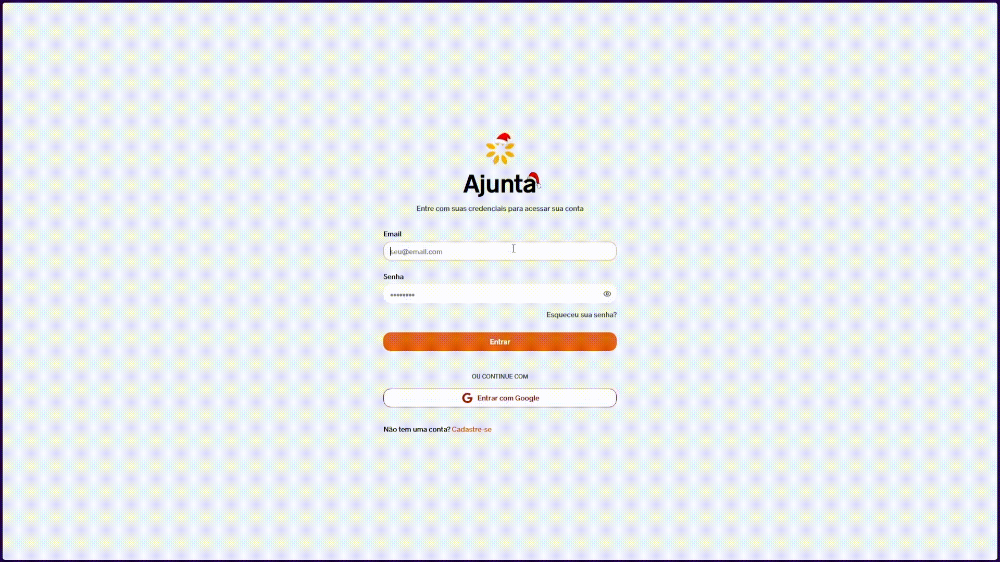
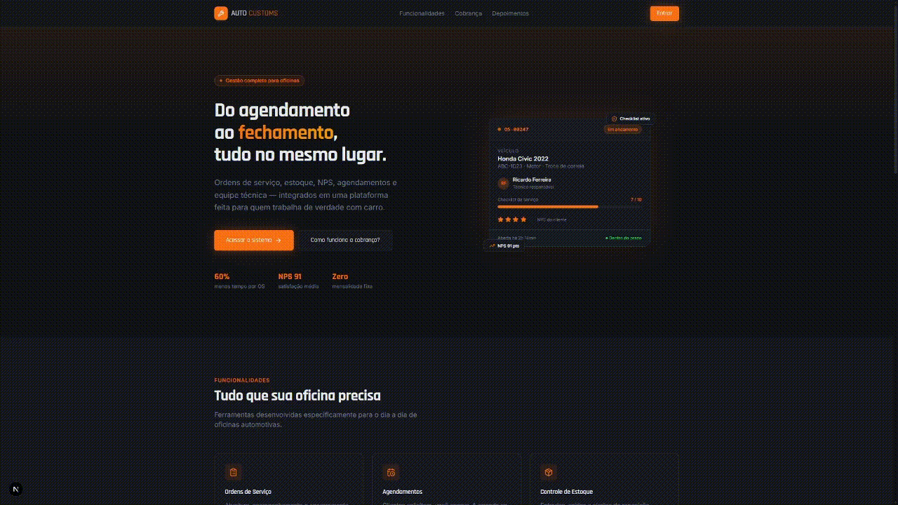

<h1 align="start" style="border: none; border-bottom: 1px solid #ccc;">Bem-vindo(a) ao perfil de Felipe Pereira 👋</h1>

<h3>👨‍💻 Sobre mim</h3>

Estudante de Engenharia de Software (PUC Minas, 6º período) com experiência prática em desenvolvimento **FullStack**, atuando atualmente como **Estagiário Desenvolvedor FullStack**, onde trabalho com refatoração de APIs REST, modelagem de bancos de dados relacionais, deploy de aplicações e desenvolvimento de interfaces web.

- Cursando Engenharia de Software
- Aprofundando conhecimentos em **Inteligência Artificial, Automação, Arquitetura de Sistemas, Design Patterns e Cibersegurança**
- 🏆 3x Melhor Projeto Interdisciplinar (PUC Minas)
- Contato: felipeaps0918@gmail.com

---

<h3>💻 Tech Stack</h3>

**Linguagens**

    

**Frameworks & Bibliotecas**

         

**Bancos de Dados**

   

**DevOps & Cloud**

     

**Ferramentas & Práticas**

     

---

<h3>🚀 Projetos em destaque</h3>

> 🔒 Os projetos abaixo são forks privados de trabalhos acadêmicos de código-fonte fechado.

<table>
  <tr>
    <td align="center" width="50%">
       
      <b>🎨 Ajunta</b> 
      Rede social para artistas de Contagem - MG, conectando talentos, recrutadores e público.  
      <code>Next.js</code> <code>React</code> <code>TypeScript</code> <code>Go</code> <code>Python</code> <code>GraphQL</code> <code>PostgreSQL</code> <code>RabbitMQ</code> <code>Docker</code> <code>AWS</code>
    </td>
    <td align="center" width="50%">
       
      <b>🚗 AutoCustoms</b> 
      Plataforma B2B2C que conecta clientes a serviços automotivos e oferece gestão modular para lojistas.  
      <code>Flutter</code> <code>React</code> <code>TypeScript</code> <code>Go</code> <code>Python</code> <code>Terraform</code> <code>Docker</code> <code>AWS</code>
    </td>
  </tr>
</table>

---

<h3>📊 GitHub Stats</h3>

  

  
  

---

<h3 align="center">🌐 Contato</h3>

  
  
  

 

  

<!-- Proudly created with GPRM ( https://gprm.itsvg.in ) -->
